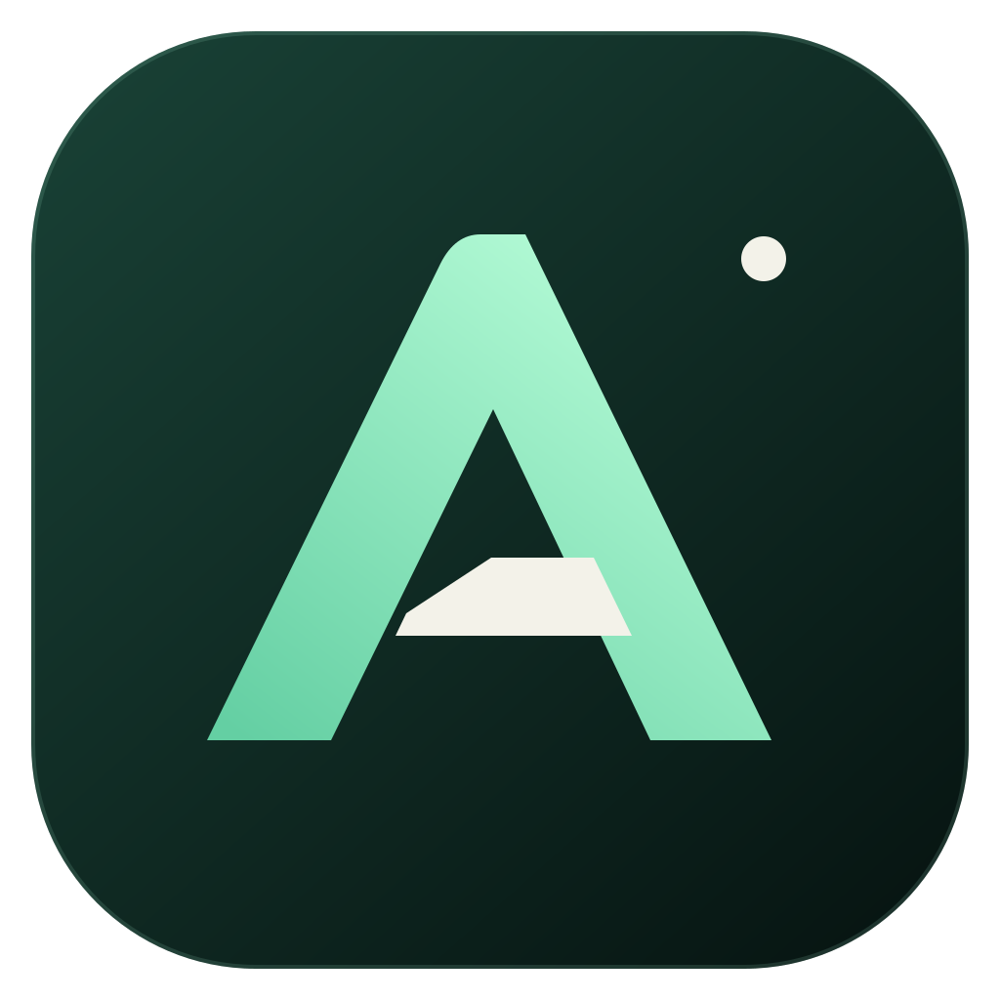
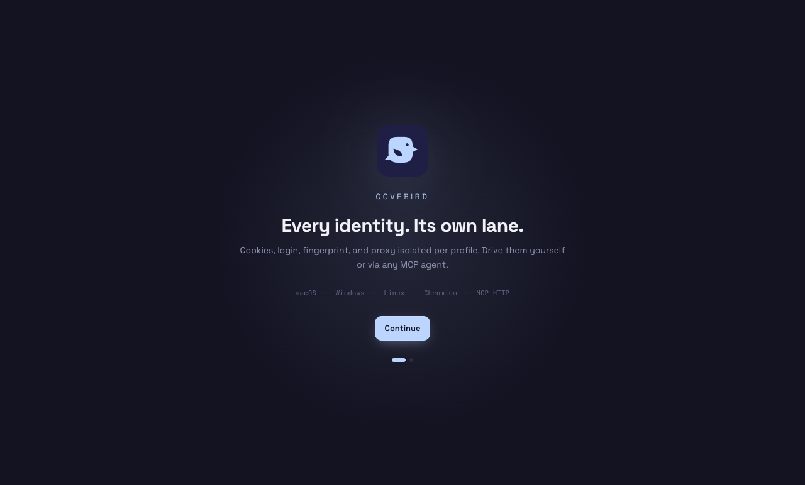

<div align="center">
  
  <h1>Covebird</h1>
  <p><strong>Every identity. Its own lane.</strong></p>
  <p>Independent browser workspaces, encrypted Cloud Sync, and an MCP gateway.</p>
</div>

Covebird is the independently branded continuation of this fork. The rebrand is in development; the current published release is still MultiZen 0.4.3.

## Upstream updates without losing our features

[Brand and integration guide](branding/README.md). Original MultiZen improvements are merged into an isolated review branch. Conflicts, edits to fork-owned code, or failing compatibility tests stop the integration. Nothing automatically merges into main or publishes a release.



## What it is

Covebird is a desktop app that runs a library of isolated browser profiles. Each profile has its own cookies, login state, fingerprint, and proxy, and runs on your choice of engine — CloakBrowser (Chromium) or Camoufox (Firefox). A local MCP server on `127.0.0.1:7777` exposes browser-drive tools (navigate, click, type, extract, screenshot, evaluate JS, cookies, tabs, waits) to any MCP client.

The result: your AI agent in Cursor or Claude Desktop can complete real authenticated workflows. Cookies and session state survive between launches, so logins and context carry over across AI sessions.

## Install

### macOS

Download the architecture-matched DMG from [this fork's releases](https://github.com/irensaltali/multizen-browser/releases/latest), then drag Covebird into Applications. This fork includes Cloud Sync and the MCP gateway. Use this repository’s builds; upstream installers do not include the fork additions.

The Mac build uses ad-hoc signing. If macOS blocks the downloaded app, run:

```sh
xattr -cr /Applications/Covebird.app
```

### Linux

```sh
curl -LO https://github.com/irensaltali/multizen-browser/releases/latest/download/Covebird-linux-x86_64.AppImage
chmod +x Covebird-linux-x86_64.AppImage
./Covebird-linux-x86_64.AppImage
```

Some distros need `libfuse2` (`apt install libfuse2t64` on Ubuntu 24.04+).

On Ubuntu 24.04+ (and other kernels that restrict unprivileged user namespaces) the browser's sandbox is blocked by default. On the first affected launch Covebird offers a one-time **secure setup**: it installs a small AppArmor profile that re-permits the sandbox for just this browser (one password prompt). The sandbox then stays on with no warning banner. You can also run or re-run it later from Settings. If you decline or it can't run, Covebird launches the browser without the sandbox so it still works.

Prefer to do it by hand? Settings shows the exact command; it writes `/etc/apparmor.d/multizen-cloakbrowser` and loads it with `apparmor_parser`. To force sandbox-off regardless, launch the AppImage with `--no-sandbox`.

### Windows

Download [Covebird-win-x64.exe](https://github.com/irensaltali/multizen-browser/releases/latest/download/Covebird-win-x64.exe). SmartScreen may flag the installer as unrecognized on first download. Click **More info**, then **Run anyway**.

## How it works

```
+----------------------+         +-----------------------+
|  Cursor / Claude     |  MCP    |  Covebird Desktop App |
|  Desktop / Cline     | <-----> |  127.0.0.1:7777       |
+----------------------+         +-----------+-----------+
                                             |
                                             | spawn / drive (CDP)
                                             v
                              +--------------+--------------+
                              |  Profile A  |  Profile B  | ...
                              |  cookies    |  cookies    |
                              |  proxy LU   |  proxy US   |
                              |  Win 145    |  macOS 145  |
                              +-------------+--------------+
                                            |
                                            v
                                  patched Chromium binary
                                  (canvas, WebGL, audio,
                                   font, WebRTC fingerprints
                                   spoofed at C++ level)
```

Each profile is a real Chromium window with persistent state on disk. The MCP server speaks the standard Anthropic Model Context Protocol over Streamable HTTP (plus legacy SSE) so it works with any client. Browser-drive tools call into Chrome DevTools Protocol under the hood.

## Features

|  | What it does |
| --- | --- |
| **MCP server** | Native localhost endpoint. Works with Cursor, Claude Desktop, Cline, Continue, anything else that speaks MCP. |
| **Per-profile engine** | Choose each profile's browser: **CloakBrowser** (Chromium) or **Camoufox** (Firefox-based, for a genuinely non-Chrome TLS/JS fingerprint). |
| **Anti-detect Chromium** | Source-patched browser engine (CloakBrowser). Canvas, WebGL, audio, fonts, WebRTC IP all spoofed at C++ level instead of JS injection. |
| **Persistent state** | Cookies, login, IndexedDB, localStorage stay per-profile across launches and across AI sessions. |
| **Cross-platform persona** | Run a Windows persona on a Mac host (or vice versa). C++ patches keep the fingerprint coherent across V8, Blink, and CSS feature signatures. |
| **Proxy + persona alignment** | Per-profile HTTP or SOCKS5 proxy with a local SOCKS5 bridge so DNS resolution stays remote. Auto-aligns timezone, locale, and `navigator.geolocation` to the proxy egress IP. |
| **Self-hosted** | Profiles live on your disk in plain SQLite plus Chromium user-data-dir format. No account, no license server, no telemetry. |
| **Open source** | MIT for the entire app, MCP server, and CDP driver. Patched Chromium engine is also open source. |

## Onboarding

Create a named profile, then configure its browser, proxy and optional sync settings.

## Connect an agent (Codex, Cursor, Claude Desktop)

After installing, the MCP server starts on `127.0.0.1:7777`. It serves the current
**Streamable HTTP** transport at `http://127.0.0.1:7777/mcp` (plus a legacy HTTP+SSE
endpoint at `/sse` for older clients).

The server requires a **bearer token** — it is generated on first run and shown in
the app under **MCP → Connect an agent** (also written to the `mcp-token` file in
the app data directory). Every client config below must send it as
`Authorization: Bearer <token>`. Replace `<token>` with your own. The app's MCP
panel has a **Copy for LLM** button that hands the whole setup (token included) to
a coding agent if you'd rather not edit config files by hand.

**Codex CLI** (`~/.codex/config.toml`) — connects to Streamable HTTP directly:

```toml
[mcp_servers.multizen]
url = "http://127.0.0.1:7777/mcp"
http_headers = { Authorization = "Bearer <token>" }
```

**JSON URL clients — Cursor** (`~/.cursor/mcp.json`), Cline, Continue:

```json
{
  "mcpServers": {
    "multizen": {
      "url": "http://127.0.0.1:7777/mcp",
      "headers": { "Authorization": "Bearer <token>" }
    }
  }
}
```

**Claude Desktop** (`~/Library/Application Support/Claude/claude_desktop_config.json` on macOS)
— its config has no `url` field, so bridge the endpoint through
[`mcp-remote`](https://www.npmjs.com/package/mcp-remote) (needs Node):

```json
{
  "mcpServers": {
    "multizen": {
      "command": "npx",
      "args": ["mcp-remote", "http://127.0.0.1:7777/mcp", "--header", "Authorization: Bearer <token>"]
    }
  }
}
```

Restart your client. The agent now has the full tool set — profile lifecycle (`list_profiles`, `launch_profile`, `close_profile`), page driving (`navigate`, `click`, `type`, `extract`, `screenshot`, `evaluate_js`), tabs (`list_tabs`, `new_tab`, `activate_tab`, `close_tab`), cookies (`get_cookies`, `set_cookies`), waits (`wait_for_load`, `wait_for_navigation`, `wait_for_selector`), and raw `cdp_send`.

## Projects — let Covebird write the agent config for you

The **Projects** screen (⌘2) is the alternative to editing the config files above
by hand. A project is a named bundle of MCP endpoints that Covebird installs into
the folders you nominate, for the agents you pick.

A project holds four things:

- **Upstream MCP servers** — `stdio` (command + args) or `http` (URL) servers that
  Covebird proxies, each becoming its own endpoint at
  `http://127.0.0.1:7777/mcp/proxies/<project>/<server>`.
- **A browser profile** (optional) — bind one and the project also serves
  `http://127.0.0.1:7777/mcp/projects/<project>/browser`, the browser-drive tools
  scoped to that one profile. Binding is **exclusive**: a profile belongs to at
  most one project, and a bound profile cannot be deleted until you unbind it.
- **Local folders** — zero or more directories on this machine.
- **Per-folder agents** — for each folder, any of **Claude Code**, **Cursor**,
  **Codex**, **kiro-cli**.

For every folder × agent pair Covebird maintains that agent's workspace config:

| Agent | File it manages |
| --- | --- |
| Claude Code | `<folder>/.mcp.json` |
| Cursor | `<folder>/.cursor/mcp.json` |
| Codex | `<folder>/.codex/config.toml` |
| kiro-cli | `<folder>/.kiro/settings/mcp.json` |

Writes are **merge-only and reversible**. Covebird owns exactly the entries it
created (named `multizen_<project>_<server>`) and leaves every other server,
setting, key order, indentation, and — in the TOML case — every hand-written
comment untouched. Each write is a backup-then-atomic-rename with a read-back
verify, and it aborts rather than clobbering a file that changed underneath it.
Removing a server, unselecting an agent, unlinking a folder, or deleting the
project removes only Covebird's own entries. If a file can't be cleaned up, the
project is kept and the failure is reported instead of leaving orphaned entries
behind.

Each folder row shows the managed file path, whether it is up to date, and — when
something fails — the reason plus what to do about it, with a retry button.

**Secrets never enter these files.** Anywhere a server needs a credential you can
either paste the value — Covebird puts it in your OS keychain and writes only a
`${NAME}` reference into the project config — or name an environment variable to
read it from at launch. Either way the config, and therefore anything that syncs
to another device or lands in an agent's config file, holds a reference and never
a value. Pasted values are write-only: no control in the UI or on the IPC surface
reads one back, so an existing credential shows as "stored" and is kept unless you
deliberately replace it. The **References** section lists every `${NAME}` a project
uses and where each one resolves from.

**Test before you commit.** The server editor has a **Test connection** button that
launches the server once (or calls the URL), completes the MCP handshake, reports
the server's name and the tools it advertises, and shuts it down again. Failures
come back with the reason, a suggestion, and the command's own stderr — usually the
only thing that explains why a command died. The value you just typed is used for
the test without being stored, so you can test, adjust, and test again before
saving. A passing test is not a precondition for saving: a server that is merely
offline, or waiting on a credential supplied elsewhere, must still be configurable.

**Per-project tokens** are the same story. Turn on "require a token", generate
one, and it is shown **once** — after that only its hash is kept. The generated
agent configs reference the variable name
(`MULTIZEN_PROJECT_<ID>_<DIGEST>_TOKEN`), which you export in the shell that runs
the agent. The token itself is never written into a config file.

Note that project endpoints are only actually served while the MCP HTTP transport
is enabled in Settings; the Projects screen tells you when the listed URLs are
configured but not yet listening.

## Stack

| Layer | Tech |
| --- | --- |
| Desktop shell | Electron 33 |
| Renderer | React 19, Tailwind v4, TypeScript strict |
| Main process | TypeScript ESM, electron-vite, native MCP SDK |
| MCP server | `@modelcontextprotocol/sdk` over Streamable HTTP + SSE |
| Profile storage | better-sqlite3 with idempotent migrations |
| Browser driver | chrome-remote-interface over CDP (Chromium); playwright-core (Firefox) |
| Browser engine | CloakBrowser (patched Chromium) or Camoufox (Firefox), per profile |
| Build | Yarn 4 workspaces, electron-vite, electron-builder |
| CI | GitHub Actions matrix on macOS, Windows, Linux |

## Develop

```sh
git clone https://github.com/irensaltali/multizen-browser
cd multizen-browser
yarn install
yarn dev            # launch the desktop app in dev mode
yarn mcp:dev        # run the MCP server standalone for testing
yarn typecheck      # strict TS across all workspaces
yarn build          # full release build (mac/win/linux per OS)
```

Requires Node 22+ and Yarn 4 (via Corepack).

## Fork releases and updates

Updates come exclusively from `irensaltali/multizen-browser`. On macOS the app checks for updates and links to the matching DMG; silent installation is not enabled for ad-hoc signatures. Windows and Linux use electron-updater's install flow. Kopia is bundled in the Mac releases; Windows/Linux Cloud Sync still requires a compatible Kopia installation on PATH.

To publish the next version from the tested `main` branch:

```sh
yarn release:version 0.5.1
yarn install --immutable
yarn typecheck
yarn test
git add package.json apps/desktop/package.json
git commit -m "chore(release): 0.5.1"
git tag -a v0.5.1 -m "Covebird 0.5.1"
git push origin main v0.5.1
```

The `Release` workflow verifies the tag, runs tests, and packages Apple Silicon, Intel, Windows, and Linux builds. It validates artifact hashes and combines the Mac architecture feeds before publishing a completed GitHub Release. Failed builds never update the public feed. Publishing uses the repository's built-in `GITHUB_TOKEN`; no personal token is needed. For a failed run, fix the cause and publish a new version, or rerun the same workflow if the failure was transient. If only the workflow needs a fix (such as a retired runner), dispatch `Release` from `main` with the existing `release_tag`; all builds still check out and verify that tag. Do not move published tags.

`yarn dist:mac arm64` creates a local installer without publishing. The separate `Build macOS distributables` workflow is manual and produces downloadable Actions artifacts only.

Preserve fork features when incorporating upstream: fetch `upstream`, merge its `master` into this fork's `main`, resolve conflicts, and run the test suite. Do not reset `main` to upstream or change the fork's update destination.

## Cloud Sync

Single-writer profile sync across Macs with **no coordination
backend**. There is no Worker, no application server, and no cloud compute to
deploy: ownership leases and revisions are coordinated by atomic conditional
writes to the **same private object store** that holds the encrypted profile
bytes. The desktop uses [`@multizen/s3-coordinator`](packages/s3-coordinator)
(built on `@aws-sdk/client-s3`) against R2, AWS S3, or a capability-verified
generic S3 endpoint. The same per-device S3 credentials authenticate both the
Kopia data plane and the coordination control plane.

**Whole-library, automatic.** Once the global switch, bucket, S3 key pair, and
encryption password are set, the desktop automatically runs a single-flight S3
health/conditional-write probe and then a **library bootstrap**—at startup and
whenever configuration becomes complete. No separate connection-test click or
per-profile Sync ID is required. The bootstrap restores every remote profile that
is missing locally (never overwriting same-id local data), enables sync for the
whole library, and uploads local changes. From then on the normal lifecycle
needs **no manual lease buttons**: launching a synced profile auto-acquires its
lease and restores/conflict-checks the latest revision; closing the browser
publishes the changes automatically and then releases the lease. On failure the
profile stays dirty and the lease is kept for an automatic retry. Running
profiles defer their upload to close. Advanced retry tools (Acquire / Restore /
Back up now / Release, and "connect a single profile by ID") remain available in
the UI as fallbacks, and **Sync all** re-runs the library bootstrap on demand.

**What syncs, what never does.** The table below is exhaustive for the two sync
channels — browser profiles (Kopia snapshots) and MCP gateway configuration
(signed, encrypted control objects). Anything not listed does not travel.

| Asset | Syncs? | Notes |
| --- | --- | --- |
| Browser profile data (cookies, local storage, IndexedDB, user-data-dir) | Yes | Kopia snapshots, encrypted with your password |
| Sanitized profile manifest (name, tags, fingerprint, proxy host/port/type) | Yes | Proxy **passwords** are not included |
| Profile extensions | Yes | Restored with the profile |
| MCP project configuration (servers, transports, `${NAME}` references) | Yes | Signed per revision, encrypted at rest |
| Project deletions | Yes | Signed tombstones, so a delete propagates instead of being undone |
| App settings — **shared subset only** (theme, MCP HTTP on/off, auto-update, engine auto-update) | Yes | Per-device fields are excluded; see below |
| Folder → agent bindings and approved env names | Yes, **per device** | Backed up for the machine that owns them; offered to other machines only as proposals, never applied |
| MCP server credentials and project bearer tokens | **Only if you opt in** | Off by default. Sealed with a *separate* passphrase using Argon2id; see [credential-backup.md](docs/cloud-sync/credential-backup.md) |
| S3/R2 access key id + secret access key | **Never** | They guard the bucket; backing them up into it would collapse the layering |
| Encryption password (Kopia repository password) | **Never** | |
| Credential-backup passphrase | **Never** | Sealing it inside what it protects would reduce two factors to one |
| Device signing key (Ed25519 private key) | **Never** | A restored identity would let two machines impersonate each other |
| Device id / display name | **Never** | Device identity is what the trust and lease systems depend on |
| Per-device settings: browser engine, MCP HTTP port, the whole `sync` config block | **Never** | A platform-specific binary, a local listener that can collide, and the bucket coordinates themselves |
| Proxy passwords | **Never** | Re-entered on the receiving device |
| Executable / config paths (Kopia binary, Kopia config) | **Never** | |
| Activity logs | **Never** | |
| `settings.json` wholesale | **Never** | Only the explicitly allow-listed shared subset above |

Two of these deserve emphasis because they changed. **Credentials can now leave
the machine, but only if you switch it on**: the OS keychain is no longer
categorically excluded, it is excluded by default and admitted for an
allow-listed subset (project secrets and bearer tokens) when you supply a second
passphrase. And **app settings partially sync**: a named subset does, the rest
is device-local by an allow-list that a new field cannot silently join.

**Setting up a replacement machine.** Settings → Cloud Sync → *Set up this
device from a backup* runs one ordered pass: storage → device trust → settings →
projects → folder bindings → credentials → browser profiles. It reports each
stage separately because partial recovery is the normal outcome, and it is safe
to re-run. A brand-new device can **restore immediately** but cannot **publish**
until an existing device approves it under Devices — the flow says so rather than
blocking on a human.

**Configuration history.** Every saved project revision is archived in your
bucket with a signed timestamp. A project's History pane lists the timeline
(including its deletion, if any) and can make any retained revision current
again. Restoring republishes that content as a *new* revision rather than
rewinding, so other devices see an ordinary edit and the restore itself can be
undone. The newest 20 revisions per project are retained; older ones are pruned
automatically.

**Turning a profile off deletes its cloud backup.** Unchecking "Sync this
profile" is a destructive remote-disable, not a local flag. After a strong typed
confirmation (you type the exact profile name, or id), the desktop writes a
durable tombstone, deletes that profile's Kopia snapshot manifests, and only
then disables local sync — your local profile and its data always stay on the
device. This is an **immediate logical deletion** (the backup becomes
unrecoverable through sync and invisible to discovery); physical reclamation of
shared, deduplicated storage chunks is **eventual** (Kopia maintenance GC), so
there is no claim of immediate byte-level erasure. Re-checking the profile
revives a fresh backup line and uploads it anew.

Operator docs live in [`docs/cloud-sync/`](docs/cloud-sync/README.md):

- [Architecture](docs/cloud-sync/architecture.md) — storage-native lease/revision coordination
- [Deployment](docs/cloud-sync/deployment.md) — bucket + per-device S3 credential provisioning
- [Security](docs/cloud-sync/security.md) — vault, secret exclusions, rotation
- [MCP configuration sync](docs/cloud-sync/mcp-sync.md) — projects, trust registry, settings, bindings, history, set-up-from-backup
- [Credential backup](docs/cloud-sync/credential-backup.md) — the opt-in secret bundle and its threat model
- [Operations](docs/cloud-sync/operations.md) — automatic library sync, lifecycle, delete, recovery
- [Acceptance](docs/cloud-sync/acceptance.md) — two-Mac checklist + failure matrix

```sh
yarn test             # all sync workspaces (sync-core, s3-coordinator, kopia-adapter, settings-store, desktop:sync/:kopia)
```

No backend to deploy or run: coordination is pure object-storage I/O. Live
R2/AWS/S3 access and the two-Mac acceptance run still require your own bucket
credentials and hardware, but there is **no cloud compute to provision**.

## Repo layout

```
apps/
  desktop/                Electron + React + Tailwind GUI + main process
                          (src/main/sync/ = Cloud Sync controller, vault,
                           storage coordinator)
packages/
  mcp-server/             MCP server exposing the browser-drive tools
  cdp-driver/             Thin wrapper around chrome-remote-interface
  profile-manager/        SQLite profile CRUD + encrypted local storage
  settings-store/         App-level settings persistence (incl. sync config)
  sync-core/              Pure sync decision logic (leases, revisions, conflicts)
  s3-coordinator/         Storage-native lease/revision coordinator over
                          conditional S3/R2 writes (no backend)
  kopia-adapter/          Shell-free Kopia CLI wrapper (snapshot/restore, S3/R2)
  types/                  Shared TypeScript types
docs/
  cloud-sync/             Cloud Sync MVP operator/provisioning docs
.github/
  workflows/release.yml   Matrix build, tag-triggered
```

## Roadmap

Things landing in upcoming releases.

- **Behavioral injection**: humanized mouse paths, keystroke timing, scroll jitter applied at the CDP input layer.
- **Team workspaces**: shared profile pool with audit log.

## Why Covebird vs the alternatives

| | Covebird | Browserbase / Hyperbrowser | GoLogin / AdsPower / Multilogin |
| --- | :---: | :---: | :---: |
| Native MCP server | yes | yes | profile CRUD only |
| Drives the browser through MCP | yes | yes | no |
| Anti-detect at C++ level | yes | partial | yes |
| Persistent login across sessions | yes | per-session | yes |
| Self-hosted | yes | no | no |
| Manual GUI for operators | yes | no | yes |
| Pay per browser-hour | no | yes | varies |
| Open source core | yes | SDK only | no |

## Acceptable use

Building a multi-account browser is dual-use. We support QA testing across roles and regions, agency workflows you are authorized to run, market research, multi-marketplace e-commerce ops, AI-driven sales engineering, and personal accounts you legitimately own. We do not support platform ToS violations, mass account farming, ban evasion, or fraud.

## License

[MIT](LICENSE). Use it however you want.

<div align="center">
  <br/>
  <sub>
    Built in transit by <a href="https://github.com/oboshto">@oboshto</a>.<br/>
    Star this repo if Covebird is useful, it helps a lot.
  </sub>
</div>

## Attribution

Based on [MultiZen](https://github.com/multizenteam/multizen-browser). Original MIT license and copyright notices are retained in [LICENSE](LICENSE). Covebird is an independent fork.
